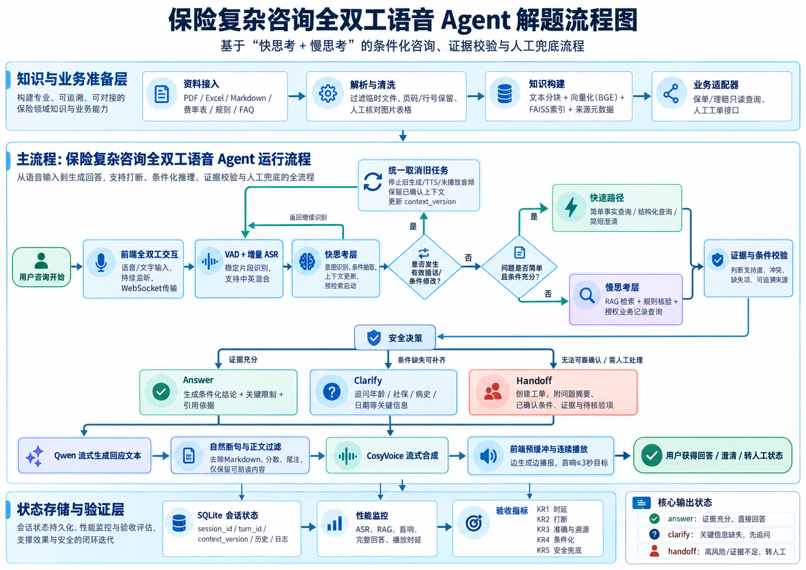

项目仓库：[InsureVoice-Agent](https://github.com/guaishouxiao732-code/InsureVoice-Agent.git)

### 方案总体流程

## 一、命题解读

赛道：语音交互与智能体。命题名称：保险复杂咨询全双工语音 Agent。命题编号：**OPEN-JS-01**。难度：困难。

### 1. 核心任务

构建“快思考 + 慢思考”协同的全双工语音 Agent，将用户具体情况与保险条款、业务规则和授权历史记录结合，完成低延迟、条件化、可追溯的保险咨询。

围绕尊享百万医疗保险，以电话咨询与投保引导为主要业务场景，完成以下任务：

1. **自然语音交互**：支持边听边查、边说边听，用户插话时停止旧回答，接续新问题并更新上下文。
2. **快慢协同处理**：快思考负责意图识别、简单问答、澄清与上下文管理；慢思考负责复杂条款检索、规则判断和历史记录查询。
3. **条件化业务回答**：针对既往病史、投保条件和理赔问题，结合年龄、社保、健康情况、产品版本和事件日期判断适用条件，输出结论及限制。
4. **安全决策与人工交接**：根据证据和信息完整程度选择回答、澄清或主动转人工，为人工提供用户条件、问题摘要和相关依据。

### 2. 关键约束条件

命题硬性约束包括：

1. **响应时效**：首响不超过 3 秒，复杂问题完整回答不超过 10 秒；首次有效回应应与用户问题相关，不能仅播放无意义的占位话术。
2. **打断与上下文**：自然打断成功率不低于 95%，打断后保留已确认信息，正确处理用户对年龄、病史和被保险人等条件的修改。
3. **准确与溯源**：复杂咨询回答准确率不低于 90%；业务结论可追溯至条款、规则或授权业务记录，引用内容实际支持对应结论。
4. **个性化判断**：回答须体现用户具体情况。未知条件保持未知，通过澄清补齐，不以默认值替代，不简单套用 FAQ 或固定话术。
5. **安全兜底**：无法可靠确认时主动转人工，不编造条款、保费、承保承诺、理赔结论、案件状态或引用来源；没有人工接收确认时不得宣称转接完成。

工程范围采用本地部署、单用户运行，支持中文、英文及中英混合咨询。GPU 1 承担语言生成，GPU 0 承担语音合成，CPU 承担语音识别与检索；服务启动时加载并预热模型。在此范围内，以预热首音频 P95 不超过 2.5 秒作为内部优化目标，同时单独记录冷启动和异常网络情况下的性能。上述工程目标与运行条件不替代命题的硬性验收要求。

### 3. 最终交付要求

交付一套可运行、可演示、可复现、可验收的系统，具体包括：

1. **完整运行代码**：全双工语音链路、自动快慢路由、上下文管理、RAG 检索、条件化推理、证据校验和人工转接模块，以及清晰的模块接口。
2. **保险知识与规则资产**：PDF、Excel 等资料的解析结果和向量索引，经核对的费率表、业务规则、产品版本与来源元数据，并提供更新和重建方法。
3. **业务对接能力**：只读保单/理赔记录查询适配器和人工工单接口；对演示数据与真实业务数据明确标识，转接状态可查询。
4. **交互与演示页面**：电脑和手机自适应网页，支持语音与文字咨询、连续播放、自然打断、历史会话、回答依据查看和人工接待。
5. **部署与使用材料**：Conda 环境配置、模型与设备配置、启动指令、知识库维护说明、故障排查和现场演示脚本。
6. **验收材料**：独立复杂问答集、条件变化测试、插话与噪声测试、自动化回归结果，以及逐项对应 KR1–KR5 的性能、准确率、引用和转人工报告。

### 4. 关键成果与实现对应

| 命题要求 | 方案中的具体机制 | 验收证据 |
|---|---|---|
| KR1：首响 ≤ 3 秒，复杂问题完整回答 ≤ 10 秒 | 快速意图识别、边听边查、模型预热、生成与 TTS 流水线、精简完整口述 | 浏览器实际播放时间、后端分阶段日志、超时样本清单 |
| KR2：自然打断，打断后上下文连贯 | 持续监听、VAD、回声抑制、统一取消、轮次与上下文版本管理 | 至少 100 次有效插话测试，停止成功率 ≥ 95%，追问连贯性记录 |
| KR3：复杂咨询准确率 ≥ 90%，每条回答可追溯 | 多来源检索、规则核验、结论与证据逐项绑定、可回查的业务记录 | 独立复杂问答集、人工评分、实际引用支持检查 |
| KR4：根据用户情况条件化回答 | 年龄、社保、病史、保单等结构化信息，已知/缺失/冲突条件判定 | 对比测试：改变用户条件后，结论、澄清问题或转人工决定随之变化 |
| KR5：不确定时主动转人工，不编造答案 | 安全决策优先、人工转接工单及状态、带证据和缺失信息的交接摘要 | 不确定问题测试、转接记录、接收确认；无虚假条款和业务状态 |

### 5. 一票否决边界

题目明确列出三条红线：纯 FAQ 匹配加固定话术、没有条件化推理；不支持打断或打断后上下文丢失；回答无法追溯来源或存在编造。达标组合应覆盖“全双工交互 + RAG 检索 + 条件化推理 + 安全兜底”。FAQ 只能作为经审核的知识来源或加速缓存，不能代替对用户条件和条款的判断。

## 二、难点剖析

### 1. 响应速度与回答准确性的平衡

“30 岁多少钱”属于事实查询，“高血压多年，投保后住院是否赔付”则涉及健康告知、既往症和责任免除。统一使用长答案会增加等待时间；统一使用短答案又可能遗漏关键条件。需要按问题复杂度分配检索与生成预算，并在完整分析完成前尽快输出有效回应。

### 2. 多格式资料的解析与定位

知识资料包括 PDF 投保须知、责任免除、年缴及月缴费率表，Excel 保险责任表，以及 Markdown 场景说明。不同格式需要不同解析策略，同时必须保留出处。费率 PDF 的核心表格是图片，普通文本提取无法覆盖，采用人工核对转录，并以 OCR 与表格识别辅助资料维护。

### 3. 语义相关不等于证据充分

向量检索容易找到与问题相似的文字，但该文字未必支持答案。例如场景说明中的“高血压能报吗”仅为示例问题，不能证明承保或赔付结论。需要区分场景配置与产品证据，结合相似度、词面覆盖以及答案支持程度判断是否可以作答。

### 4. 多轮对话和打断的一致性

用户可能在回答尚未结束时提出新问题。系统必须停止旧文字生成、旧语音合成和未播放音频，同时保存已确认的对话内容，避免残留语音与新回答混合，也避免把未完成结论当成完整事实。

### 5. 语音首响与连续播放

等待完整答案后再合成会延迟首响，切分过短又会产生断句生硬和停顿。需要让文字生成、语音合成和前端播放形成流水线，通过自然断句、音频队列和预缓冲维持连续播放。

### 6. 高风险业务的安全边界

实际承保和理赔受到用户具体情况、健康告知、保险合同及审核结果影响。系统应说明适用条件，避免“一定可以买”“一定能赔”等确定性承诺。对无法确认的问题，需要明确表达不确定性，并设计人工核验或转接路径。

### 7. 边听边查中的识别修正与过期结果

用户说到“高血压”时可以开始预检索，但随后可能补充“我是替父亲问”或修正“不是高血压，是低血压”。预检索结果必须绑定识别片段、会话轮次和上下文版本。关键条件改变后，应取消或废弃过期结果，再检索新条件，避免先入为主。

### 8. 条款、规则、咨询历史与理赔记录的区别

条款解释产品责任，业务规则辅助判断适用条件，咨询历史描述此前用户说过什么，理赔记录描述真实案件状态。SQLite 中的聊天记录不能直接充当真实理赔进度。系统必须区分这些来源，查询案件状态时只使用经授权的业务接口；没有接口或记录时不得猜测。

## 三、方案选型

| 技术环节 | 选型 | 选择依据 |
|---|---|---|
| 语言模型 | Qwen3-4B-Instruct-2507 | 支持中文和流式生成，可本地部署，兼顾响应速度与资源占用 |
| 文本向量 | BGE-small-zh-v1.5 | 适合中文检索，规模较小，可在 CPU 运行 |
| 向量库 | FAISS | 本地检索快速、依赖较少，适合单机部署 |
| 会话存储 | SQLite | 支持持久化与会话隔离，无需额外数据库服务 |
| 语音识别 | SenseVoice | 离线识别，支持中文、英文及中英混合 |
| 语音合成 | CosyVoice-300M-SFT | 支持流式合成，中文女声自然，适合连续播放 |
| 网页服务 | FastAPI + WebSocket | 支持流式文字、音频和打断指令传输 |
| 演示入口 | 响应式网页 + 临时公网隧道 | 便于电脑、手机及异地测试访问 |

资源安排为：GPU 1 运行 Qwen，GPU 0 运行 CosyVoice 并承担桌面显示，CPU 运行 ASR 和向量检索。模型在服务启动时加载并预热，后续请求复用模型实例。

采用自动意图识别与任务路由，把事实查询分配到快速路径，把复杂条件问题分配到检索分析路径。页面保留手动模式作为调试入口，实际咨询以自动路由结果为主。

### 1. 快慢协同的职责与调度

快路径负责意图识别、会话条件更新、简单事实查询、澄清以及接收打断；慢路径负责复杂检索、规则核验、授权业务记录查询和条件化答案组织。拟采用轻量分类与结构化抽取结合的路由，模型输出经过字段校验；低置信度问题进入澄清或慢路径，不依赖用户自行选择模式。

两个路径共用统一会话状态和安全规则。对于复杂问题，快路径在收到稳定识别片段时启动检索，必要时给出与问题有关的简短澄清；慢路径得到证据后输出完整结论。首响不能用无意义的“请稍等”刷指标，更不能抢先给出未核验的业务结论。单机部署优先共享已加载的 Qwen，通过任务优先级和取消减少 GPU 竞争，不预设同时运行两个大模型。

### 2. 条件化推理与证据校验

为每个会话维护年龄、社保状态、产品版本、保障责任、病史、住院原因、投保/出险日期和案件标识等字段。每个字段记录来源轮次、是否已确认、更新时间；不知道的字段保持未知，不能补成默认值。

将经业务人员审核的规则组织为“适用产品与版本—前置条件—例外或责任免除—输出结论—条款/规则编号—原始出处”。条件判定采用满足、不满足、未知三种状态；未知关键条件进入澄清或转人工。大模型负责理解自然语言、提取条件和解释结果，明确数字与条件由结构化表格和已审核规则核验。

每项业务结论绑定真正支持它的证据，不把全部召回片段都视为已引用来源。若文件版本冲突、结论缺少证据、案件状态无记录或用户条件不全，安全分支优先于流畅生成。

### 3. 全双工与转人工状态

目标交互采用“监听—预检索—生成/播放—被打断—更新条件—重新生成”的状态流，监听贯穿播放阶段。用户有效插话触发统一取消；“嗯、好的”等附和和背景噪声需要单独判断，避免每个声响都打断。

对话决策输出明确状态：`answer`（证据充分）、`clarify`（缺少可补充条件）、`handoff`（无法可靠确认或必须人工处理）。转人工应创建可查询的记录，包含原因、已确认条件、待核验问题、证据与会话摘要；收到人工队列接收确认后才向用户声明转接成功。

比赛阶段没有生产客服接口时，拟实现网页人工接待台，由演示工作人员接收工单并确认。该方式用于验证转接闭环，并在材料中注明为演示接待台；后续按客服系统的接口接入正式队列。

### 4. 条件化回答示例

以“我有高血压好几年，一直吃药，买这个以后住院能报吗”为例，系统先区分“能否投保”与“某次住院能否理赔”，提取病史和长期服药事实；不把“有高血压”直接推断为一定承保或一定拒赔。

慢路径检索对应产品版本的健康告知、责任免除和保障责任，检查是否存在可适用的核保规则。若缺少完整健康告知或正式核保结论，则记录缺失项并触发人工核验，可先说：“您提到有高血压并长期服药，目前资料不足以确认能否承保或赔付，我将为您申请人工进一步核实。”此时只能说正在申请，不能声称转接完成。

若用户继续说“不是我，是我父亲”，快路径停止当前回答、更新被保险人并澄清父亲年龄；慢路径按新条件重新查询。若用户改问“我的理赔到哪一步了”，则切换到授权案件查询，输出真实记录中的状态、更新时间和记录标识；查不到记录时转人工，不沿用上一轮的通用保障说明。

对于“扣掉 1 万元后是不是都能报”，规则核验分别检查费用是否属于保障责任、等待期、医院范围、医保结算、补偿原则、免赔额和赔付限额。只有已确认条件和来源支持时才给出对应比例；未知条件用条件句说明或主动澄清，不能把“扣除免赔额后按约定比例”简化为“所有费用全报”。

## 四、步骤拆解

### 第一阶段：建立可追溯的保险知识库

读取资料目录中的有效文件，排除 `__MACOSX`、`._*`、`.~*` 和 `~$*` 临时文件。PDF 按物理页提取，Excel 按工作表及行提取，Markdown 按正文提取。

对图片费率表建立人工核对转录，引用仍指向原始费率 PDF，并注明“人工核对转录”。场景说明纳入资料清单，但不参与产品事实证据判断。

将文本分块后使用 BGE 向量化，写入 FAISS，并保存文件清单、哈希、片段数量和来源位置。源资料变化后显式重建索引，并核对关键业务答案。

产出：知识索引、来源元数据与资料版本清单。验证：核对文件数量、费率转录、PDF 页码和 Excel 行号。

### 第二阶段：完成检索与证据约束生成

用户问题先进行向量化，再召回相关片段。使用向量相似度与词面覆盖率双重门控，初始阈值分别为 0.47 和 0.08，通过独立测试集校准。

证据充分时，将资料片段、来源标签和问题一起送入 Qwen，要求关键结论附带引用，并对每项结论执行证据支持检查。将候选片段、提供给模型的资料和真正支持结论的证据分开记录，只展示实际引用的来源。

证据或关键条件不足时，先说明无法确认；条件能够补齐时询问必要信息；无法可靠回答、证据冲突或需要人工核保/理赔判断时主动触发转人工。通用模型知识不能替代具体产品条款或真实案件记录。

对于承保和理赔，保留“以健康告知、核保结论、保险合同及理赔审核为准”的说明，但这句话不能代替证据校验或人工转接。增加逐项答案支持校验、转接工单和前端状态显示，禁止没有接收确认就声称已经联系人工。

产出：RAG 客户端、证据判定与回答规则。验证：价格、免赔额、责任免除和领域外问题测试。

### 第三阶段：实现上下文与快慢路径

使用 SQLite 保存会话、历史、生成状态、检索来源和性能指标。不同会话使用独立 ID，支持恢复、删除和打断后的状态保存。

结合指代词、历史主题与年龄、社保状态、产品、既往症等结构化会话信息进行检索，提高省略式追问的稳定性。

年龄、社保和病史等关键条件由用户明确表达或确认后更新；例如用户说“不是我，是我父亲”，应切换被保险人并重新核实其年龄，不能沿用原用户年龄。为每轮任务附加 `session_id`、`turn_id` 和 `context_version`，只有当前版本结果才能进入答案和音频队列。

理赔进度通过独立的只读业务查询适配器获取。优先对接主办方提供的历史记录或客服接口；在接口缺失阶段，可用明确标注的模拟案件测试调度和溯源，不能将模拟状态展示为真实用户案件结果。

快路径以事实查询和简短回答为主；慢路径处理多条件分析和跨文件咨询。通过意图分类自动路由，并针对价格等确定性问题采用结构化查询或计算。

产出：上下文管理器、快慢模式与路由设计。验证：连续追问、主题切换、会话隔离与恢复。

### 第四阶段：构建流式语音链路

完整处理顺序为：

持续采集用户音频 → VAD 与增量语音识别 → 稳定片段预检索 → 句末确认与上下文更新 → 证据核验及 Qwen 流式生成 → 自然断句 → CosyVoice 流式合成 → 前端预缓冲与连续播放。

第一段文字适当缩短以尽快触发 TTS；后续段落适当加长，减少合成边界。前端使用连续音频队列和约 1 秒预缓冲。语音仅朗读正文，过滤 Markdown 标记、来源标签、检索分数和尾注。

产出：ASR/TTS 接口和语音问答服务。验证：首音频延迟、断句自然度、长回答卡顿次数及中英混合识别。

### 第五阶段：实现自然打断与全双工交互

在助手播放语音期间持续监听，结合 VAD、回声消除、增量识别和说话结束判定，区分有效插话、背景噪声和扬声器回声。有效插话或新消息触发统一取消：停止旧生成和合成，丢弃尚未播放的音频，并标记旧回答状态。

通过浏览器持续采集音频帧，经 WebSocket 上传；结合 VAD 与滑动窗口识别产生部分文本，对稳定前缀进行预检索，句末确认后再生成业务结论。浏览器启用回声消除和降噪，并通过扬声器播放场景实测处理效果。SenseVoice 的窗口增量方案先验证性能与识别质量，必要时替换为流式 ASR，并保持接口兼容。

插话确认后先在前端停止播放，再向服务端传递取消令牌。Qwen、检索任务、TTS 和音频队列统一检查轮次与取消状态，阻止旧音频迟到后再次播放。日志区分“已经生成”“已经发送”和“实际播放”；打断后保留用户已经听到的信息及未完成标记，尚未播放的内容不得当作用户已知事实。

产出：统一取消机制与全双工交互模块。验证：播放中插话、背景噪声误触发、回声干扰和打断后的上下文连贯性。

### 第六阶段：完成网页与演示交付

网页采用对话中心布局，包含历史会话、快慢模式、文字输入、录音、播放、停止生成、删除会话和回答依据查看。手机端将历史与设置收纳为抽屉。

短期演示采用固定密码保护的公网隧道，正式运行可迁移到固定域名与 HTTPS 服务。

产出：可演示网页、启动说明和验收报告。验证：电脑与手机操作、异地访问、登录保护与完整业务流程。

### 第七阶段：对齐比赛交付与后续落地

10 月 9 日 12:00 前提交六部分解题思路和 KR 对应说明；10 月 15 日初赛演示全双工、条件化问答、引用与人工兜底链路；决赛阶段围绕 10 月 22 日交付节点完善噪声鲁棒性、业务接口和独立测试报告。各阶段均以对应功能测试和 KR 验收结果作为完成依据。

研发优先级为：先完成人工兜底和条件化证据校验，再完成持续监听、自然打断和版本一致性，随后优化边听边查与延迟，最后完善生产客服、知识库和授权记录接口。页面美化安排在关键指标通过之后。

## 五、验证方法

### 1. 建立业务标准问答集

由人工根据资料整理标准结论、适用条件和出处，覆盖保费、保额、等待期、免赔额、社保结算、责任免除、健康告知、续保及领域外问题。将开发调优题与正式验收题分开，增加不同表达、信息不完整和多轮追问，避免只对固定示例有效。

| 测试场景 | 预期行为 |
|---|---|
| 30 岁有社保，年缴多少钱？ | 根据核对后的费率表检索到基础年缴费率 318 元，引用原始费率来源并说明适用范围 |
| 30 岁有社保，月缴多少钱？ | 检索到基础月缴费率 31 元，并引用月缴费率来源 |
| 自己先掏 1 万，剩下是不是全报？ | 说明免赔额、责任范围、补偿原则及 100%/60% 的适用条件 |
| 高血压多年一直吃药，住院能报吗？ | 提取病史并检索规则；缺少核保依据时说明无法确认并申请人工核验 |
| 先问年缴，再问“那月缴呢” | 正确继承年龄、社保状态和产品 |
| 询问资料未覆盖的业务内容 | 明确资料不足，主动触发人工转接并展示真实状态，不伪造出处 |
| 你是人工客服吗？ | 如实说明是 AI 助手 |

### 2. 验收口径与硬指标

语音测试以用户真实说话结束为 `t0`，将端点检测等待计入响应时间；首段有意义语音实际开始播放为 `t1`，完整必要答案生成结束为 `t2`，完整口述实际播放结束为 `t3`。首响采用 `t1 - t0`，同时记录 `t2 - t0` 和 `t3 - t0`。前端使用同一计时基准记录用户结束和实际播放，后端记录各阶段耗时，用轮次 ID 关联日志。

完整回答同时记录文字生成完成和语音播放完成两个时间，以完整、精简的口述在 10 秒内结束作为设计目标。通过缩短答案结构、提前检索和并行流水线控制总时长；引用详情保留在页面，不必逐字朗读。语音答案仍须包含结论、关键条件和必要安全说明，验收同时核对答案完整性与真实播放时长。

| 指标 | 测试与判定 | 标准 |
|---|---|---|
| KR1 首响 | 单用户、预热及冷启动分别测试，报告每例、P50/P95、最大值和超时比例；有效首响不能仅为通用占位话术 | 命题 ≤ 3 秒；内部优化目标为预热 P95 ≤ 2.5 秒 |
| KR1 复杂完整回答 | 对复杂题同时记录完整文字和完整口述结束时间，检查答案是否遗漏条件 | 命题 ≤ 10 秒；任何超时样本明确列出，不能用平均值掩盖 |
| KR2 自然打断 | 真实语音插话，旧音频停止、旧任务取消、无过期结果、新轮能继承或修正上下文，四项同时满足才算成功 | 成功率 ≥ 95%；另报告插话到静音的延迟及误打断率 |
| KR3 准确率 | 至少 100 个独立复杂案例，由业务人员核对结论、条件、证据和应答/澄清/转人工决定 | 合格案例数 / 全部复杂案例数 ≥ 90%；纯简单报价题单独统计 |
| KR3 可追溯 | 逐项检查业务结论所引条款/规则是否支持它；案件查询对应真实记录及查询时间 | 所有业务回答均可追溯；无来源时只澄清或转人工，不能编造来源 |
| KR4 条件化 | 至少 30 组配对问题，仅改变年龄、社保、被保险人、病史、日期等关键条件 | 按适用规则改变结论、澄清或转接决定，不复用相同通用话术 |
| KR5 安全兜底 | 至少 30 个缺失证据、资料冲突、无授权记录和超出业务权限案例 | 每例按预期澄清或主动转人工，无编造，无虚假转接成功提示 |
| 连续播放 | 长回答记录浏览器真实缓冲耗尽与断流，并人工听评 | 目标无明显卡顿；服务端预计缓冲指标仅作辅助 |

不确定案例的标准答案由业务人员预先标注，正确转人工可以记为该案例通过；对于已有充分依据的可回答案例，滥用转人工不算正确。延迟测试不以短促占位语音替代业务首响，准确率也不以无差别拒答获得。

### 3. 测试集与现场演示

至少准备 100 个有效插话案例，覆盖开场、中途、句末、用户修改条件、切换问题、网络迟到音频和手机扬声器回声；另准备噪声、附和词等非插话负例，评估误打断。多轮测试覆盖年龄继承、社保修改、被保险人切换、历史纠正、会话恢复和多会话隔离。

现场建议按以下顺序演示：

1. “我 30 岁有社保，多少钱？”——快速报价并展示真实费率来源。
2. 播放中插话“等等，是我父亲，65 岁”——立即停止旧音频、更新条件、重新检索。
3. “他有高血压还一直吃药，住院能赔吗？”——展示条件提取、责任与规则检索、缺失条件及人工核验决定。
4. “是不是先掏 1 万，剩下都报？”——解释医保结算和责任条件，展示对应来源，避免绝对承诺。
5. 查询真实授权的理赔记录；若无生产接口，使用明确标注的演示案件，演示记录回查及缺失记录转人工。
6. 人工接待台接收转接请求，显示工单状态及交接摘要，证明转接不是只说一句提示。

### 4. 自动化与端到端证据

执行 `python -m unittest discover -s tests -v`，验证会话隔离、持久化、恢复、删除、取消、RAG 回退、来源标注与语音正文过滤。

回归测试覆盖自动路由、结构化条件更新、来源支持校验、迟到结果淘汰、自然插话和人工转接状态。网页端验证从录音、识别、检索到实际播放的完整链路，逐项核对 KR 验收结果。

性能测试应在模型预热后重复执行，分别记录 ASR、RAG、首文字、首音频、完整回答及播放缓冲指标，同时保留冷启动测试结果。使用网页实际链路验证，避免仅测后端模型速度。

每次验收留存硬件与环境信息、代码版本、资料版本、测试集版本、轮次日志、失败案例及原因。语音录像和浏览器播放日志用于证明真实交互，避免仅用服务端预测值说明播放无卡顿。

### 5. 对齐评审权重

| 评分维度 | 权重 | 本方案的证明材料 |
|---|---|---|
| OKR 贡献度 | 50% | 首响与完整回答时间、复杂咨询准确率、打断成功率、KR1–KR5 对应报告 |
| AI 原生度 | 20% | 全双工实录、边听边查、用户条件变化后的推理和自动路由，区别于 FAQ 固定匹配 |
| 可落地性 | 15% | 客服转接、知识库更新和业务记录查询适配器，配置与启动说明，真实/模拟接口边界 |
| 创新性 | 10% | 快慢任务协同、主动澄清、上下文版本更新与过期结果淘汰机制 |
| 演示质量 | 5% | 连贯现场脚本、复杂咨询与插话实录、证据面板和人工接待操作 |

实施中优先复用研发中心提供的语音交互框架与知识库基础，以及业务部门提供的条款、规则、FAQ 和历史咨询记录。通过统一适配器对接实际可用接口，对暂缺接口提供明确标注的演示数据，并分别验收流程功能和真实业务对接效果。

## 六、风险与备选

### 1. 图片表格与数字错误

图片解析或转录错误可能影响费率。采用人工逐项核对，结合 OCR 与结构化表格辅助提取，并对年龄区间、社保状态、年缴/月缴单位建立校验。报价说明实际价格以投保页面及核保结果为准。

### 2. 检索误召回与证据不足

双重门控仅用于初筛，不能保证内容足以支持答案。后续增加重排序、问题拆解与答案支持校验。涉及高风险结论且资料不足时，优先澄清必要信息并提示人工核验。

### 3. 资料不足与人工转接失败

资料不足时说明无法确认，并根据缺失信息选择必要澄清或主动转人工，通用模型知识不得作为产品结论的依据。人工不可用或转接失败时，记录真实失败状态并提供已配置的后续联系途径，不猜测业务结论，不声称转接成功。

### 4. 核保资料不完整

缺少完整健康告知或个体病史时，不应直接判断能否承保。采用补充询问与人工核验路径，提示如实告知，避免确定性承诺。

### 5. 真正全双工的噪声和回声干扰

持续监听可能把助手播放声音识别成用户插话。先以耳机环境验证 VAD 和增量识别，再增加回声消除、插话确认与误打断测试。保留按键录音方式作为演示备选。

按键录音可用于故障定位与备用访问，但它不等同于全双工；若连续监听和自然插话验收未通过，应明确列为未达标项，不能以备用模式宣称满足题目。

### 6. 语音卡顿和延迟波动

通过自然断句、预缓冲和持续音频队列降低卡顿；根据合成速度动态调整分段。GPU 分工、模型预热和单用户限制降低资源竞争，遇到异常时保留文字回答。

### 7. 演示网络与资料版本变化

临时公网地址可能变化，演示前验证电脑和手机访问，并准备本机访问方式。记录知识文件哈希，源资料更新后重建并重新核对关键答案，避免混用不同版本。

### 8. 缺少真实业务记录和客服系统接口

优先取得主办方允许使用的脱敏记录与接口。对保单及理赔查询建立用户授权、标识核验、只读权限和日志，访问不到记录时直接说明并转人工。模拟数据可验证功能流程，不能用来证明真实业务对接或实际案件准确性。

### 9. 性能与准确率目标相互挤压

对复杂问题先预检索，再核验关键证据，采用“结论—适用条件—下一步”短口述控制时长，详细来源在页面查看。超过时间预算且无法得到可靠结论时说明当前无法确认并转人工，记录为超时或转接案例；不能通过删去免责条件、加速到听不清或编造结论达到延迟目标。
